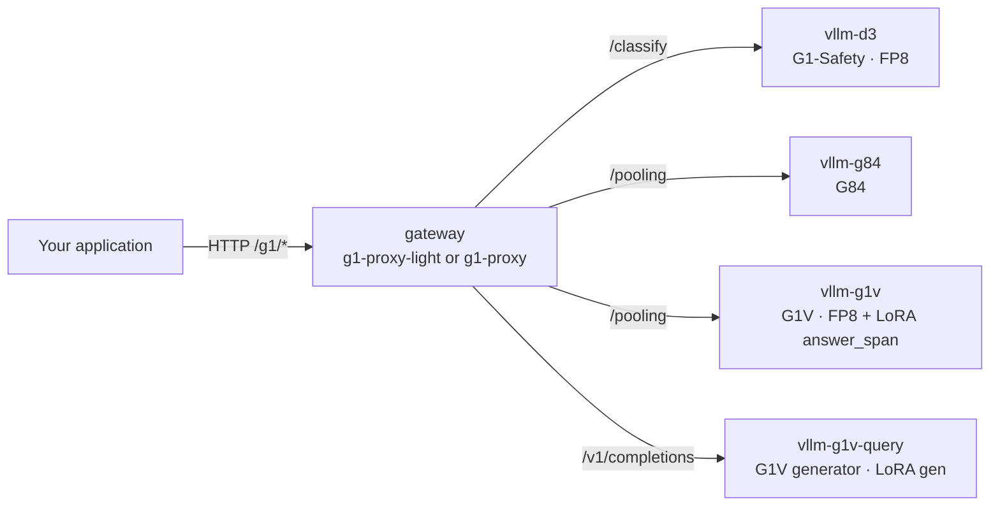

# 2.0 Architecture — the vLLM stack

!!! abstract "TL;DR"
    From **2.0.0** every Geodesia model is served by **vLLM**, in **FP8**, from one image — `glad-vllm` — that carries
    **all the model weights inside it**. The gateway (`g1-proxy-light` or `g1-proxy`) is a small Python image with no
    PyTorch that talks HTTP to four vLLM containers. One GPU with **24 GB** of memory runs the whole stack (21.5 GiB measured).
    You install it with `install.sh`; nothing else is downloaded or mounted.

The 1.x line ran the models inside the gateway process (PyTorch). That line is documented in the other pages of this
section and keeps working. This page describes the 2.0 line only.

---

## The five containers

| Service | Image | What it serves | GPU memory (FP8, measured) |
|---|---|---|---|
| `vllm-d3` | `glad-vllm` | **G1-Safety** — safety reader (level 1, and level 2 together with G84), custom policy | 6.5 GiB |
| `vllm-g84` | `glad-vllm` | **G84** (Geodesia-G) — fast safety reader (level 0) | 1.6 GiB |
| `vllm-g1v` | `glad-vllm` | **G1V** — hallucination verdict, sentences and words | 6.5 GiB |
| `vllm-g1v-query` | `glad-vllm` | G1V read as a generator — the **search queries** of `/g1/sufficiency` | 6.5 GiB |
| `gateway` | `g1-proxy-light` or `g1-proxy` | the HTTP API, the configuration UI, the call log, authentication | CPU only |

**Total measured on the complete stack: 21.5 GiB of GPU memory. Supported minimum: 24 GB.** With 16 GB the stack
does not fit (measured), and 4-bit weights were evaluated and **rejected** for G1V because quality dropped too far.

The four vLLM containers use the **same image**. `glad-vllm` is about 33 GB because it contains vLLM, the Geodesia
plugins and the four weight sets (`/models/d3_86_a075`, `/models/G84_vllm`, `/models/g1v`, `/models/lora/*`). The
gateway image is about 0.5 GB (code, the configuration UI and 83 MB of tokenizers and configuration files) — it contains no weights.



!!! note "Why four vLLM servers"
    A vLLM instance serves one pooling task. The G1-Safety safety reader, the G84 encoder and the two G1V roles (reader and
    query generator) are different architectures or tasks, so each gets its own instance. They start **one after the
    other**, because vLLM measures the free GPU memory at start-up.

## What runs where

| Level / endpoint | Models used |
|---|---|
| level 0 — `/g1/safety-fast` | G84 |
| level 1 | G1-Safety |
| level 2 — `/g1/safety`, default of `/g1/eval` | G84 + G1-Safety fused |
| `/g1/hallucination-context`, `/g1/sufficiency` | G1V (+ G1V generator for the queries) |
| `/g1/hallucination-closedbook` | G1V |

There is **no level 3** and no Geodesia-H / Geodesia-A tier in 2.0: see [Thinking Levels](thinking-levels.md).

## Precision

Weights are loaded in **FP8** (weight-only FP8 with the Marlin kernels on Ampere GPUs): `fp8_per_tensor` for G1-Safety, `fp8_per_block` for G1V.
Quality of the FP8 G1V reader against the reference runtime on the same 200 rows: **verdict 194/194 identical decisions**,
sentences **195/200**. The word-level weights differ more (they are a relative signal, see
[Hallucination API](hallucination-api.md#words)).

## Requirements

| | |
|---|---|
| GPU | one NVIDIA GPU with **at least 24 GB** (Ampere or newer) |
| Driver / toolkit | NVIDIA driver **≥ 580**, `nvidia-container-toolkit` **≥ 1.19** |
| Software | Docker Engine with Compose v2 |
| Disk | about 35 GB for the images |
| First start | 10–40 minutes (kernels are compiled once, later starts are faster) |

## Install, update, remove

```bash
chmod +x install.sh
GLAD_LICENSE_TOKEN=glc_… ./install.sh light      # or ./install.sh proxy
./install.sh update                              # newer images, asks per component
./install.sh status
./install.sh down
```

See [The install.sh installer](../installer.md#installsh-20) for every option, and
[Environment Variables](../configuration/env-vars.md#20-stack) for the tuning variables.

## Health

| Route | Meaning |
|---|---|
| `GET /health` | the gateway is up |
| `GET /g1/safety/health` | `{"status":"ok","servers":{"g84":true,"G1-Safety":true}}`; `503` with `"degraded"` when a model server does not answer |
| `GET /g1/hallucination/health` | the same for the G1V servers |

A model server that is down gives **`503 model_unavailable`** — never a silent "allow". Treat it as "the check did not happen".

## What the 2.0 line does not have yet

Stated plainly so that a missing capability is not mistaken for a bug:

- **`g1-proxy` 2.0 is the light engine with the full profile.** The knowledge base (RAG), the reference check
  (`verify_references`) and the other accessories of the 1.x proxy are **not ported to vLLM yet**; their routes answer `404` in 2.0.
- **`rag_jailbreak` is off.** The safety routes do not read documents (`400 context_not_supported`); `/g1/eval` still
  scans a supplied context with the prompt axes.
- **Chat routes need an LLM upstream.** `/g1/*` evaluation routes need none; the proxying routes (`/v1/chat/completions`)
  need `UPSTREAM_URL` / `UPSTREAM_MODEL`.
- **Closed-book** is a weaker check than grounded hallucination: use it as a signal.
